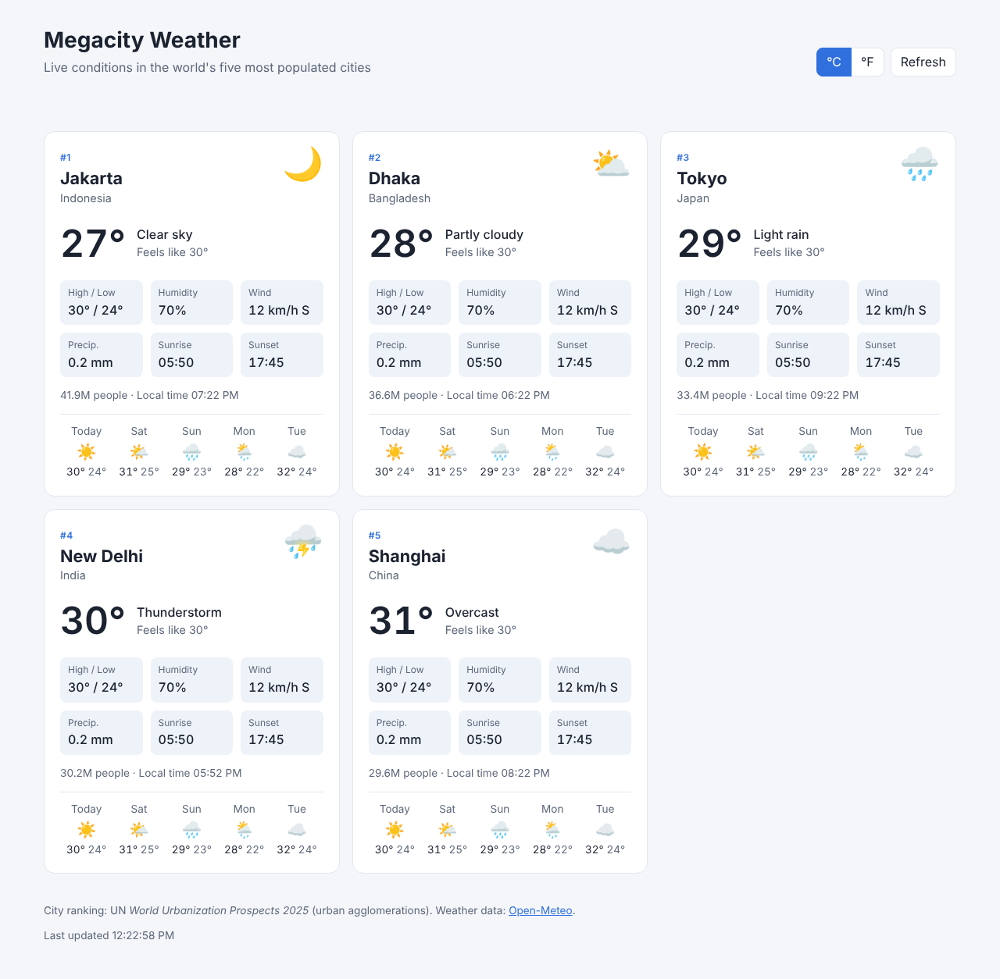

# Megacity Weather

A small static web app showing live weather for the world's five most populated cities
(by urban agglomeration, UN *World Urbanization Prospects 2025*):

1. Jakarta, Indonesia
2. Dhaka, Bangladesh
3. Tokyo, Japan
4. New Delhi, India
5. Shanghai, China

For each city it shows the current temperature, feels-like temperature, conditions, today's
high/low, humidity, wind, precipitation, sunrise/sunset, live local time and a 5-day forecast.
You can switch between °C and °F (your choice is remembered), and the data refreshes every 10 minutes.

Weather comes from [Open-Meteo](https://open-meteo.com/), which is free and needs no API key.



## Run it

There is no build step. Serve the folder with any static server, for example:

```sh
python3 -m http.server 8000
```

Then open http://localhost:8000. Opening `index.html` directly also works in most browsers.

`megacity-weather.html` is the same app bundled into a single file, so you can open it with a double-click.

## Changing the cities

Edit the `CITIES` array at the top of `app.js`.
